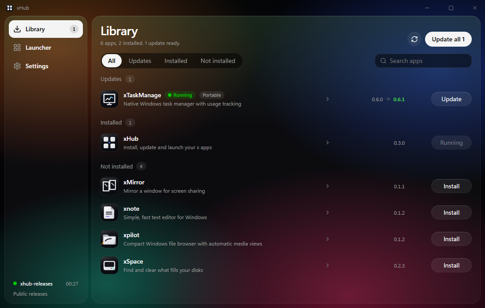
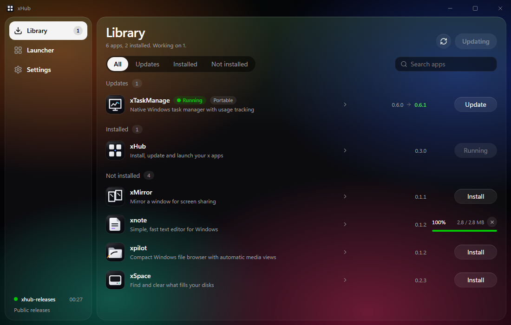
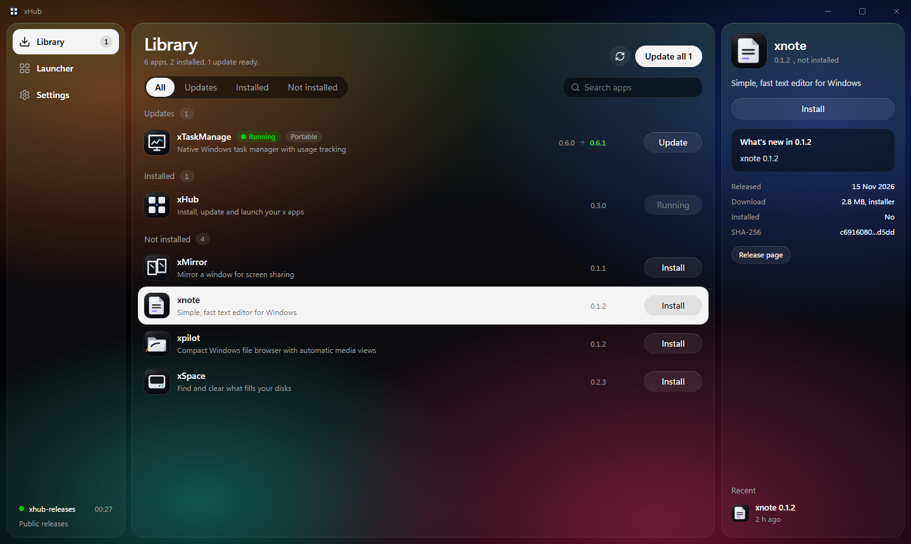
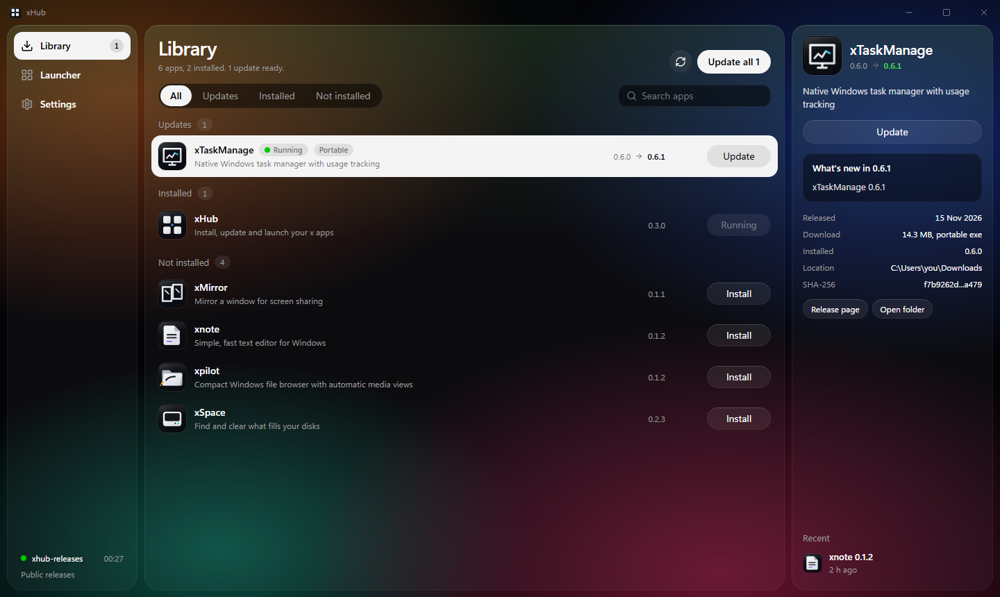
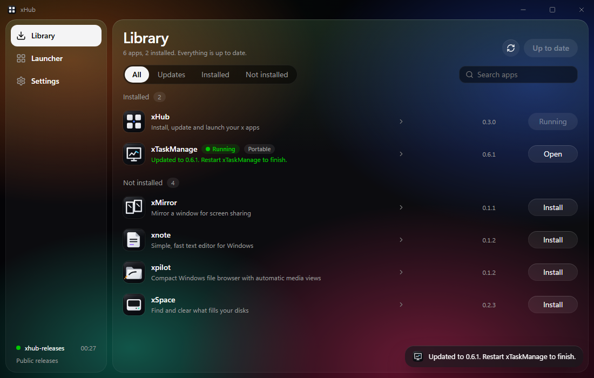
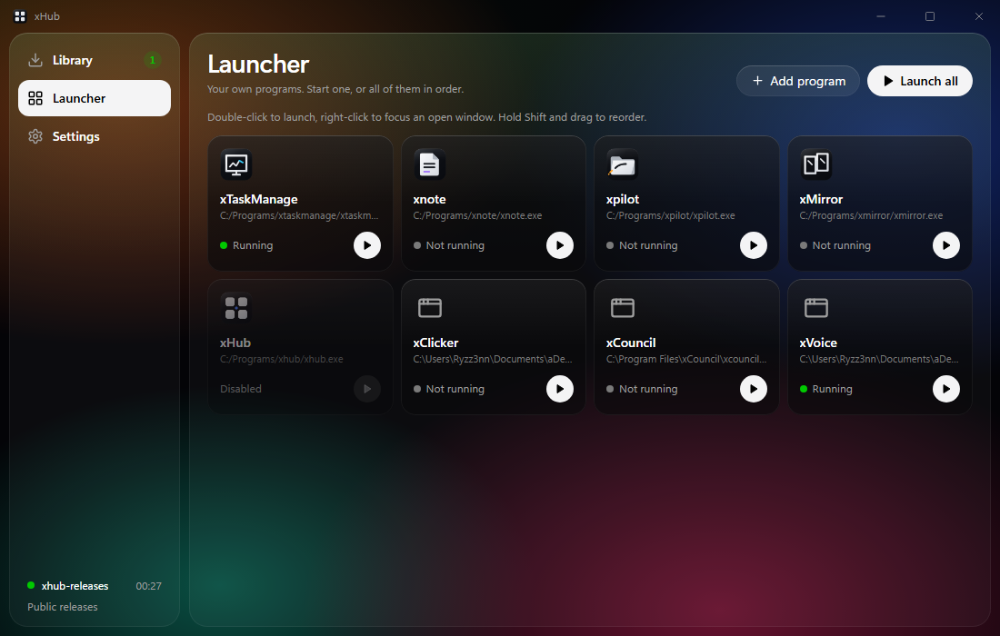
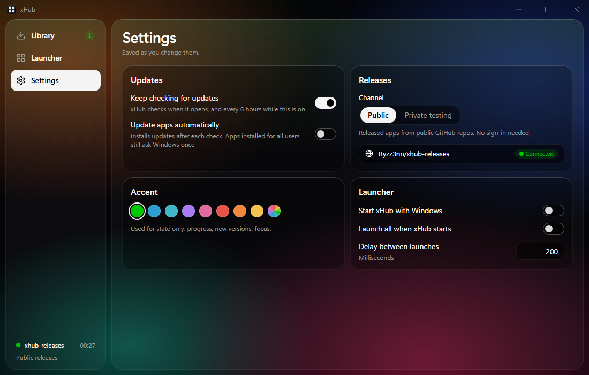

  

<h1 align="center">xHub</h1>

  One place to install, update and launch the x apps for Windows. 
  No account, no sign-in, no telemetry.

  <a href="https://github.com/Ryzz3nn/xhub-releases/releases/download/xhub-v0.3.2/xHub_0.3.2_x64-setup.exe"><b>Download xHub 0.3.2 for Windows</b></a>
  &nbsp;·&nbsp;
  <a href="https://github.com/Ryzz3nn/xhub-releases/releases">All releases</a>

## What you get

| App | What it does |
|---|---|
| **xHub** | This app. Installs, updates and launches the others. |
| **xTaskManage** | Native Windows task manager with usage tracking. |
| **xnote** | Simple, fast text editor. |
| **xpilot** | Compact file browser with automatic media views. Coming soon. |
| **xSpace** | Finds and clears what fills your disks. |
| **xMirror** | Mirrors a window for screen sharing. |

Every app is free. xHub checks for new versions when it opens and every 6 hours after that.

## Install xHub

### 1. Download

Get **xHub_0.3.2_x64-setup.exe** from the link above, or from the newest `xhub-v...` entry on the
[releases page](https://github.com/Ryzz3nn/xhub-releases/releases).

Requires Windows 10 or 11, 64-bit.

### 2. Run the installer

The installers are not code-signed yet, so Windows may warn you the first time:

- **"Windows protected your PC"** (SmartScreen): click **More info**, then **Run anyway**.
- **"Do you want to allow this app to make changes"** (UAC): click **Yes**. xHub installs for all
  users in `C:\Program Files\xHub`, which is why Windows asks once.

### 3. Open xHub

It starts on the **Library**. Every app shows one of three states:

| Button | Meaning |
|---|---|
| **Install** | Not on this PC yet. |
| **Update** | Installed, and a newer version is out. The row shows both versions. |
| **Open** | Installed and up to date. |

## Install an app

Click **Install** on any row. xHub downloads the app, checks it against the SHA-256 published in the
catalog, and runs the installer silently. Nothing else to click.

Click a row to see the details: what's new, download size, release date and the checksum.

A file that does not match its published checksum is thrown away and never run.

## Already have xTaskManage?

You don't need to reinstall anything. xHub finds the copy you already have, wherever you put it:

- the copy that is **running** right now,
- the copy **Start with Windows** launches,
- the copy your **Start menu shortcut** points at,
- or the default folder `%LOCALAPPDATA%\Programs\xTaskManage`.

It reads the version, shows **Update** if a newer one is out, and the **Location** row tells you
which copy it found.

When you click **Update**, xHub replaces that exact file, in the same folder. Your settings, usage
history and Start with Windows entry stay as they are. The previous version is kept next to it as
`xTaskManage.exe.old` until xTaskManage next starts.

If xTaskManage is running, xHub does not close it for you. The row says so:

Quit xTaskManage from its tray icon and start it again to run the new version.

**Admin mode:** if you turned on xTaskManage's admin mode, its elevated copy lives in
`C:\Program Files\xTaskManage`. xHub never writes there. It updates your normal copy, and the next
time xTaskManage starts it offers to bring the admin copy up to date (one Windows prompt). If the
admin copy is the only one on the PC, xHub shows **Open to update** and xTaskManage's own updater
takes it from there.

xTaskManage keeps its own built-in updater too. Both use the same releases, so it doesn't matter
which one gets there first.

## Launcher

The **Launcher** tab is a list of any programs you like, x apps or not. Start them one by one or all
at once, optionally when xHub starts with Windows.

## Settings

- **Keep checking for updates**: on by default.
- **Update apps automatically**: off by default. When on, xHub installs updates after each check.
  Apps installed for all users still ask Windows once.
- **Channel**: leave it on **Public**. *Private testing* is for the developer's test builds and needs a
  key you don't have.

## Uninstall

Every app, xHub included, uninstalls from **Windows Settings > Apps > Installed apps**.
xTaskManage is a single exe: quit it from the tray and delete the file.

## Privacy and safety

- xHub only talks to GitHub (`github.com`, `raw.githubusercontent.com` and GitHub's download
  hosts): one catalog file, the app icons, and the downloads you ask for.
- No account, no analytics, no tracking.
- Every download is verified against the SHA-256 in [`catalog.json`](catalog.json) before it runs.
- Updating an app that has an installer closes it while the installer runs, and xHub starts it
  again right after. xTaskManage is never closed; it asks you to restart it instead.

## Troubleshooting

| Problem | Fix |
|---|---|
| Library says it is offline | Check your connection. xHub shows the last catalog it saw until it can reach GitHub again. |
| An install stopped with an error | Click **Install** or **Update** again. A corrupt or cancelled download is never kept. |
| Windows Defender removed an app | Unsigned new releases sometimes get flagged. Restore it from *Windows Security > Protection history*, or wait a day and reinstall. |
| xTaskManage shows as not installed | Start it once, so it registers its Start menu shortcut, then click refresh in xHub. |
| Taskbar still shows an old icon | Windows caches icons. Signing out and back in refreshes them. |

This repo holds the releases, the catalog and this guide only. The source code is not published here.
